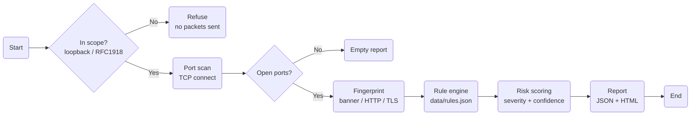
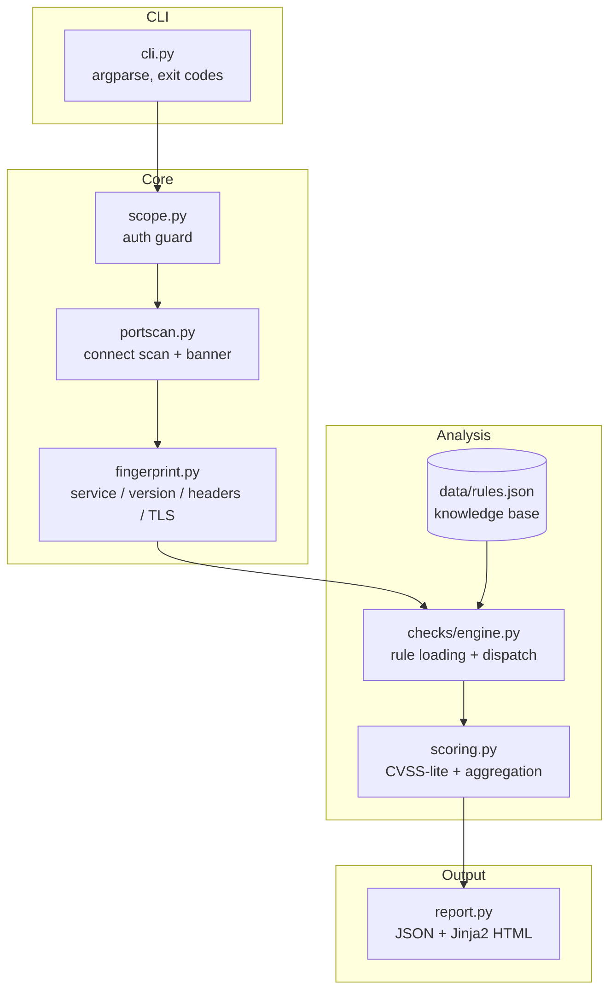
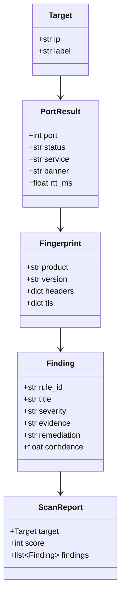
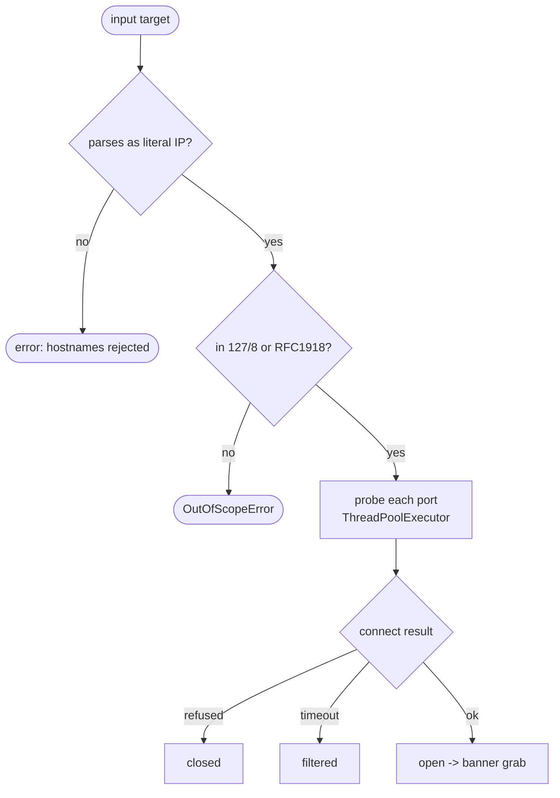

# PyVulScan — architecture

## 1. Pipeline (top level)

## 2. Module layers

## 3. Data flow (what an object looks like)

## 4. Stage-1 decision logic (detail of the guard)

## 5. Severity model

| Level | Meaning | Points |
| ----- | ------- | ------ |
| Critical | unauthenticated remote access to sensitive data | 9.0-10.0 |
| High | plaintext admin protocol, missing auth on admin panel | 7.0-8.9 |
| Medium | weak TLS, verbose version disclosure | 4.0-6.9 |
| Low | missing hardening headers, information leakage | 0.1-3.9 |
| Info | service enumeration facts | 0.0 |

Host score = `min(10, max(severity) + 0.1 * (count(medium+)) )`, so one critical
outranks a pile of lows but volume still matters.
